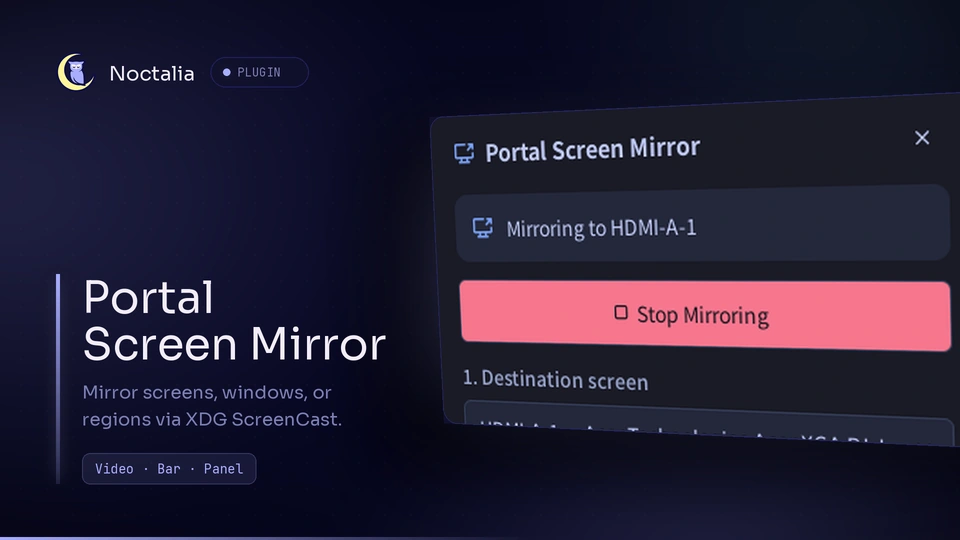

<div align="center">
  

  <h1>noctalia-plugins</h1>

  <p>Personal <a href="https://github.com/noctalia-dev/noctalia">Noctalia</a> plugin source repository by <a href="https://github.com/fumoctl">@fumoctl</a>.</p>
</div>

---

## Add This Source

Register this repository once in Noctalia to browse, install, and update any plugin listed below:

```sh
noctalia msg plugins source add fumoctl git https://github.com/fumoctl/noctalia-plugins
```

*(Using NixOS / Home Manager? Each plugin's README includes a ready-to-paste declarative snippet.)*

---

## Plugins

<table>
  <thead>
    <tr>
      <th width="340">Preview</th>
      <th>Plugin</th>
    </tr>
  </thead>
  <tbody>
    <tr>
      <td>
        <a href="portal-screen-mirror/README.md">
          
        </a>
      </td>
      <td>
        <h3><a href="portal-screen-mirror/README.md">Portal Screen Mirror</a></h3>
        <p><code>fumoctl/portal-screen-mirror</code> · <code>bar</code> · <code>panel</code> · <code>service</code> · <code>shortcut</code></p>
        <p>Mirror any screen, individual window, or rectangular region onto another display via <a href="https://github.com/fumoctl/portal-screen-mirror"><code>portal-screen-mirror</code></a> (XDG <code>ScreenCast</code> GPU <code>DMA-BUF</code>/<code>SHM</code>, <code>wlr-screencopy</code>, and a click-through <code>zwlr-layer-shell-v1</code> EGL overlay) — zero compositor window rules required.</p>
        <p>
          <a href="portal-screen-mirror/README.md"><strong>Documentation →</strong></a> ·
          <a href="portal-screen-mirror/README.md#compatibility">Compatibility</a> ·
          <a href="portal-screen-mirror/README.md#requirements">Distro &amp; NixOS Setup</a>
        </p>
      </td>
    </tr>
  </tbody>
</table>
