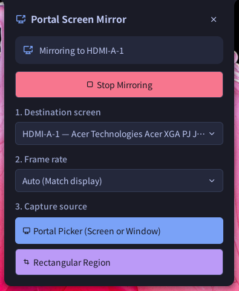

# Portal Screen Mirror

Mirror any screen, individual window, or rectangular region onto another display through [portal-screen-mirror](https://github.com/fumoctl/portal-screen-mirror) — powered by XDG `ScreenCast`, PipeWire zero-copy GPU `DMA-BUF` (with automatic `MemFd` SHM fallback), `wlr-screencopy`, and a click-through `zwlr-layer-shell-v1` EGL/GLES2 overlay surface.

## Screenshots



## Plugin

| Field | Value |
| --- | --- |
| ID | `fumoctl/portal-screen-mirror` |
| Version | `2.0.0` |
| Entries | Bar widget: `mirror`; panel: `controls`; service: `mirror-service`; shortcut: `toggle` |
| Dependency | [`portal-screen-mirror`](https://github.com/fumoctl/portal-screen-mirror) |

## Compatibility

`fumoctl/portal-screen-mirror` is compositor-agnostic across Wayland desktops where Noctalia runs, with zero compositor-specific CLI calls or window rules.

| Component | Protocol / API Used | Compositor Support |
| :--- | :--- | :--- |
| **Output discovery & UI** | `noctalia.outputs()` (`wl_output` + `xdg-output`) | Any compositor running Noctalia |
| **Mirror display surface** | `zwlr-layer-shell-v1` `Overlay` + `EGL/GLES2` (`xdg_toplevel` fullscreen fallback) | Umbriel, Hyprland, Niri, Sway, KDE KWin, River, Labwc, MangoWC (plus GNOME Mutter via fullscreen fallback) |
| **Portal Picker mode** | `org.freedesktop.portal.ScreenCast` + PipeWire GPU `DMA-BUF` (automatic `MemFd` SHM fallback) | **Full screen + individual windows** on Umbriel, Hyprland, Niri, KDE, and GNOME. **Full screen** on Sway, Labwc, and River (`xdg-desktop-portal-wlr`). |
| **Rectangular Region mode** | Built-in `zwlr-layer-shell` crosshair selector + `zwlr_screencopy_manager_v1` (or `ScreenCast` + GPU UV crop) | **Instant zero-dialog capture** on Umbriel, Hyprland, Niri, Sway, River, Labwc, MangoWC. **Automatic portal fallback** (caches per-output `restore_token`) on KDE KWin. |

## Requirements

Install the standalone [`portal-screen-mirror`](https://github.com/fumoctl/portal-screen-mirror) binary on `PATH` (no Python, GStreamer, or `slurp` required):

### NixOS / Home Manager (Flake)

Add `portal-screen-mirror` to your `flake.nix` inputs and enable its Home Manager (or NixOS) module alongside Noctalia:

```nix
# flake.nix
inputs.portal-screen-mirror.url = "github:fumoctl/portal-screen-mirror";
```

```nix
# home.nix
{ inputs, ... }:
{
  imports = [ inputs.portal-screen-mirror.homeManagerModules.default ];

  programs.portal-screen-mirror.enable = true;

  programs.noctalia.settings.plugins = {
    auto_update = "all";
    enabled = [ "fumoctl/portal-screen-mirror" ];
    source = [
      {
        name = "official";
        kind = "git";
        location = "https://github.com/noctalia-dev/official-plugins";
      }
      {
        name = "community";
        kind = "git";
        location = "https://github.com/noctalia-dev/community-plugins";
      }
      {
        name = "fumoctl";
        kind = "git";
        location = "https://github.com/fumoctl/noctalia-plugins";
      }
    ];
  };
}
```

### Arch / Fedora / Debian / Ubuntu (Cargo)

```sh
# Arch Linux
sudo pacman -S rust pkgconf clang pipewire wayland libxkbcommon libglvnd
cargo install --git https://github.com/fumoctl/portal-screen-mirror

# Fedora
sudo dnf install cargo rust pkgconf-pkg-config pipewire-devel wayland-devel libxkbcommon-devel libglvnd-devel
cargo install --git https://github.com/fumoctl/portal-screen-mirror

# Debian / Ubuntu
sudo apt install cargo rustc pkg-config libpipewire-0.3-dev libwayland-dev libxkbcommon-dev libegl-dev libgles-dev
cargo install --git https://github.com/fumoctl/portal-screen-mirror
```

*(Ensure `~/.cargo/bin` is on your session `PATH` or copy `~/.cargo/bin/portal-screen-mirror` to `/usr/local/bin`.)*

## Usage

Enable `fumoctl/portal-screen-mirror` in **Settings → Plugins**, then add the `mirror` bar widget to your bar (`type = "fumoctl/portal-screen-mirror:mirror"`) or add the `toggle` tile to Control Center shortcuts.

Clicking the bar widget opens the `controls` panel:

1. Select the **destination screen** (external displays such as `HDMI-A-1` sort ahead of `eDP-*` internal panels).
2. Choose the **frame rate** (`Auto` matches the destination display's live refresh rate in Hz, or pick `30`, `60`, `120`, or `Uncapped` — updates live on the fly without restarting the stream).
3. Click **Portal Picker (Screen or Window)** to choose any monitor or window via your desktop portal, or **Rectangular Region** to drag a region with the built-in crosshair selector.

While mirroring is active, right-clicking the bar widget (or clicking **Stop Mirroring** inside the panel) stops the stream immediately.

Open or close the panel directly from the command line or a compositor keybind with:

```sh
noctalia msg panel-toggle fumoctl/portal-screen-mirror:controls
```

## Settings

| Setting | Type | Default | Description |
| --- | --- | --- | --- |
| `show_cursor` | `bool` | `true` | Embeds the pointer cursor in mirrored streams. |
| `fit` | `select` | `"contain"` | Controls how the stream scales inside the destination output (`contain`, `cover`, or `stretch`; hot-updates live). |
| `max_fps` | `select` | `"auto"` | Default frame rate cap (`"auto"`, `"30"`, `"60"`, `"120"`, or `"0"` uncapped; hot-updates live). |
| `scale_quality` | `select` | `"balanced"` | GPU texture filter: bilinear (`"balanced"`) or crisp nearest-neighbor (`"fast"`; hot-updates live). |

## IPC

Address the `mirror-service` entry with the `all` target for keybind workflows:

```sh
# Toggle: stops an active mirror, or opens the destination + source panel
noctalia msg plugin fumoctl/portal-screen-mirror:mirror-service all toggle

# Start portal or region mode directly (optional connector name; defaults to first external output)
noctalia msg plugin fumoctl/portal-screen-mirror:mirror-service all portal HDMI-A-1
noctalia msg plugin fumoctl/portal-screen-mirror:mirror-service all region HDMI-A-1

# Stop an active mirror
noctalia msg plugin fumoctl/portal-screen-mirror:mirror-service all stop
```
